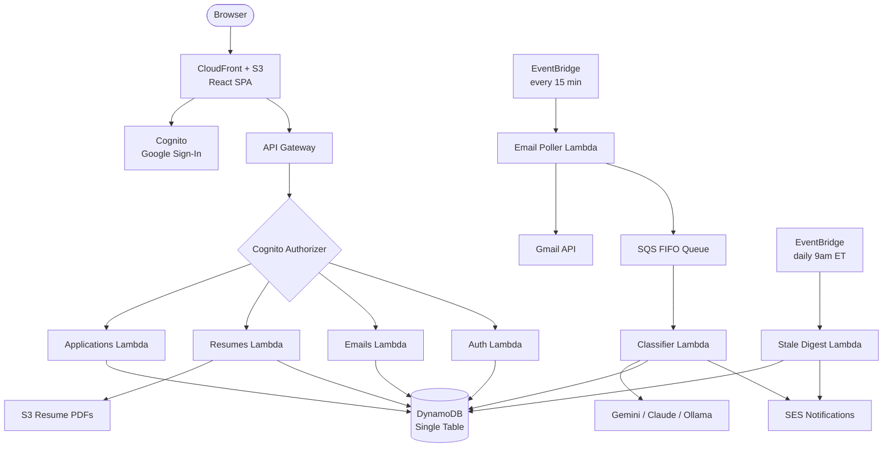

# Ghosted

Personal job application tracker. Tracks applications and resume variants, monitors Gmail with AI-powered email classification to auto-update statuses.

Live at **ghosted.macsampson.com**

---

## Architecture



The email pipeline is the interesting piece: EventBridge triggers a poller every 15 minutes, which fetches recent Gmail messages and pushes them onto a SQS FIFO queue. The classifier Lambda consumes the queue, runs a heuristic domain pre-filter to skip unrelated mail before hitting the LLM, then confidence-gates any automatic status updates (≥0.8 required). Low-confidence matches land in the review queue UI for manual confirmation.

---

## Local dev

**Prerequisites:** Docker, Node 20

```bash
# 1. Start DynamoDB Local
docker compose up -d

# 2. Create the table (first time only)
npm run db:setup

# 3. Copy and fill in the env file
cp apps/api/.env.example apps/api/.env
# Edit apps/api/.env — see comments in that file for what each var does

# 4. Start API (:3001) and web (:5173)
npm run dev
```

Auth bypass is on by default — no Cognito or Google sign-in needed locally. The API injects a fake user matching what Cognito would provide in production.

**Gmail OAuth locally:** Without `GMAIL_CLIENT_ID` / `GMAIL_CLIENT_SECRET` set, clicking "Connect Gmail" uses a mock token. To test the real OAuth flow, fill in those vars, add `http://localhost:3001/auth/gmail/callback` to the Google Cloud Console OAuth client's authorized redirect URIs, and restart the server.

**Classifier locally:** Set `GEMINI_API_KEY` for Gemini (default), `CLAUDE_API_KEY` for Claude, or run Ollama and set `OLLAMA_MODEL` + `OLLAMA_BASE_URL` for a fully local option.

### Useful dev commands

```bash
npm run db:reset          # wipe and recreate local table
npm run typecheck         # type-check all workspaces
npm run lint              # lint all workspaces
```

---

## Tests

DynamoDB Local must be running.

```bash
npm test --workspaces --if-present   # all 95 tests
npm test --workspace=apps/api        # 81 API integration tests
npm test --workspace=apps/web        # 14 web unit tests
```

---

## Deploying to production

### One-time setup (already done)

- SES: verify `macsampson.com` in SES → Verified identities
- ACM: request cert for `ghosted.macsampson.com` in `us-east-1`
- Google Cloud Console: add `https://ghosted.macsampson.com/auth/gmail/callback` to the Gmail OAuth client's authorized redirect URIs

### Deploy

```bash
# Build
npm run build --workspace=apps/api
npm run build --workspace=apps/web

# Push secrets to Secrets Manager (only needed if secrets changed)
npm run secrets:sync

# Deploy CDK stack
cd infra/cdk
cdk deploy \
  --context googleClientId=YOUR_GOOGLE_SIGNIN_CLIENT_ID \
  --context gmailClientId=YOUR_GMAIL_CLIENT_ID \
  --context acmCertificateArn=arn:aws:acm:us-east-1:ACCOUNT:certificate/CERT_ID

# Note the outputs: SpaBucketName, CloudFrontDomain, CloudFrontDistributionId

# Sync frontend to S3 and bust the cache
cd ../..
aws s3 sync apps/web/dist s3://BUCKET_NAME
aws cloudfront create-invalidation --distribution-id DIST_ID --paths "/*"
```

### What `secrets:sync` does

Reads `apps/api/.env` and pushes these keys to `ghosted/secrets` in Secrets Manager:
`geminiApiKey`, `claudeApiKey`, `encryptionKey`, `gmailClientSecret`, `googleClientSecret`

Verify with:
```bash
aws secretsmanager get-secret-value --secret-id ghosted/secrets | jq '.SecretString | fromjson'
```

---

## Stack

| Layer | Tech |
|---|---|
| Frontend | React 18, TypeScript, Vite, TanStack Query, Tailwind |
| Backend | Node 22 Lambdas, TypeScript, Zod, AWS SDK v3 |
| Database | DynamoDB single-table (`JobTracker`) |
| Auth | Cognito User Pool + Google IdP |
| Email pipeline | EventBridge → Lambda → Gmail API → SQS FIFO → Lambda → Gemini |
| Notifications | SES |
| Hosting | CloudFront + S3 |
| IaC | AWS CDK v2 |
| CI | GitHub Actions (typecheck → test → build → cdk synth) |

---

## Troubleshooting

See `aws-issues.md` for a walkthrough of every production deployment issue hit and how each was fixed.
