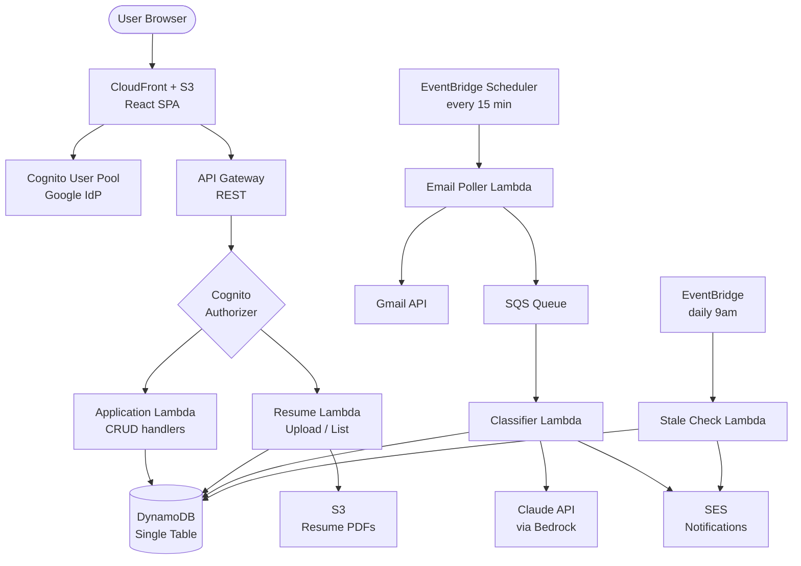

# Job Application Tracker (Ghosted) — Product Spec & Architecture

## TL;DR

A personal job search command center. Track every application, link each to the resume version you used, and let AI monitor your inbox to auto-update statuses when companies respond. Built on AWS serverless, deployable in ~2 weeks, free-tier friendly.

---

## 1. Problem & Goals

### The problem
Job searching at scale gets messy fast. You apply to 50+ roles with 4 different resume variants, recruiters email back across weeks, follow-ups slip through cracks, and you have no idea which resume version is actually performing best.

### Goals
1. Single source of truth for every application
2. Know which resume variant correlates with the most callbacks
3. Auto-detect responses so nothing falls through
4. Surface stale applications that need follow-up

### Non-goals (v1)
- Job board scraping or auto-application
- Multi-user / SaaS features
- Mobile app

---

## 2. Core Features (MVP scope)

| Feature | Description |
|---|---|
| **Auth** | Sign in with Google (also gets you Gmail scope) |
| **Application tracking** | CRUD applications with company, role, link, status, applied date, salary range, notes |
| **Resume versioning** | Upload PDF resume variants, label them, link each application to the version used |
| **Pipeline view** | Kanban board: Applied → Screening → Interview → Offer / Rejected |
| **Email monitoring** | Background job polls Gmail, AI classifies incoming mail, auto-updates application status |
| **Analytics dashboard** | Response rates per resume variant, per role type, per company size; time-in-stage metrics |
| **Stale alerts** | Daily email: "5 applications haven't been touched in 14+ days" |

### Stretch (post-MVP)
- Browser extension to one-click capture a job posting
- AI-generated cover letter per application using selected resume + job description
- Interview prep notes attached to applications

---

## 3. Architecture



### Why this shape

- **Serverless throughout** — zero cost when idle, scales to zero, fits the free tier.
- **Async email pipeline** — poller → SQS → classifier decouples ingest from AI processing. SQS gives you retries, dead-letter queues, and a clean spot to talk about backpressure in interviews.
- **Single-table DynamoDB** — one of the most asked-about AWS patterns. Worth learning properly.
- **CDK for everything** — IaC is non-negotiable for senior-leaning roles.

---

## 4. Data Model

### DynamoDB single-table design

Table name: `JobTracker`

| PK | SK | Entity | Attributes |
|---|---|---|---|
| `USER#<sub>` | `PROFILE` | User profile | email, name, gmailRefreshToken (encrypted), createdAt |
| `USER#<sub>` | `APP#<appId>` | Application | company, role, jobUrl, status, appliedAt, salaryRange, notes, resumeVersionId, lastActivityAt, statusHistory |
| `USER#<sub>` | `RESUME#<versionId>` | Resume version | label, s3Key, uploadedAt, useCount |
| `USER#<sub>` | `EMAIL#<emailId>` | Email event | applicationId, gmailMsgId, classification, snippet, receivedAt, suggestedStatus, needsReview, actionSummary, actionDeadline (last two only for `follow_up_needed`) |

### GSIs

- **GSI1** (`GSI1PK = USER#<sub>`, `GSI1SK = STATUS#<status>#<appliedAt>`) — query applications by status sorted by date, powers the pipeline view
- **GSI2** (`GSI2PK = USER#<sub>`, `GSI2SK = LAST_ACTIVITY#<timestamp>`) — find stale applications

### Status history

`statusHistory` is an append-only list of `{ status, at, source }` events (oldest first; `source` ∈ `created | manual | email_auto | email_confirmed | auto_ghosted | backfill`). It is server-managed — never accepted from client input — and appended at every status transition (`applications.ts`, `emails.ts` confirm, `classifier.ts`, `stale-digest.ts` ghost) via the shared `appendStatusHistory` helper in `lib/dynamo.ts`, which only writes when the status actually changes. It exists because current status alone can't answer how far an application progressed before a terminal outcome — the analytics funnel and time-to-first-response derive the *furthest stage reached* and *first screening+ timestamp* from this log. Legacy rows were seeded by `scripts/backfill-status-history.ts` (applied→current; terminal apps floor at `applied`).

### Application status values
`applied` → `screening` → `phone_interview` → `technical_interview` → `onsite` → `offer` → `accepted`
Terminal: `rejected`, `withdrawn`, `ghosted` (auto-set after 30 days no activity)

---

## 5. Email Monitoring Flow

This is the most interesting piece architecturally. Walk through it:

1. **EventBridge Scheduler** triggers `email-poller` Lambda every 15 minutes per active user
2. Lambda uses stored Gmail refresh token to hit Gmail API with query like `newer_than:1h -in:sent`
3. For each unread message, extract sender, subject, snippet, message ID
4. Push a message per email onto SQS (decouples API limits from AI processing)
5. **Classifier Lambda** consumes SQS messages, calls Claude with a prompt like:
   ```
   Classify this email in the context of a job application:
   From: {sender}
   Subject: {subject}
   Snippet: {snippet}

   Known applications: {list of companies user has applied to}

   Return JSON: { applicationId, classification, confidence, extractedInfo }
   ```
6. Classifications: `rejection`, `interview_request`, `recruiter_outreach`, `job_alert`, `offer`, `follow_up_needed`, `application_acknowledged`, `unrelated`
7. If matched and confidence > 0.8, update application status in DynamoDB (auto-apply is limited to `rejection`/`interview_request`/`offer`)
8. Send SES notification to user for high-priority classifications (offer, interview_request)
9. `follow_up_needed` is an action item, not a stage change: the classifier extracts `actionSummary` + `actionDeadline` onto the EMAIL# record and may set `suggestedStatus = screening` only for recruiter initial-contact emails. It never auto-applies — any suggested status is confirmed by the user in the review queue. Open follow-ups surface as a Dashboard "Action needed" widget and in the daily digest

### Key design decisions

- **Polling vs Gmail push notifications via Pub/Sub** — push is more elegant but requires GCP Pub/Sub setup. Polling is fine for v1 at 15-minute cadence.
- **Heuristic pre-filter before AI** — match sender domain against known companies first, skip AI call if no plausible match. Cuts AI costs significantly.
- **Confidence threshold** — never auto-update status without high confidence. Below threshold goes to a review queue in the UI.

---

## 6. Tech Stack

### Frontend
- React 18 + TypeScript
- Vite for build tooling
- TanStack Query for server state
- Tailwind + shadcn/ui for components
- React Router
- Auth via AWS Amplify Auth library (Cognito integration)

### Backend
- Node.js 22 Lambdas (TypeScript) — keep one language across the stack
- AWS SDK v3
- Powertools for Lambda (logging, tracing, metrics)
- Zod for validation

### Infra
- AWS CDK v2 (TypeScript)
- GitHub Actions for CI/CD
- CloudWatch for logs/metrics, X-Ray for tracing

### External
- Gmail API (OAuth 2.0)
- Claude API direct (simpler than Bedrock for v1, swap later if needed)

---

## 7. Build Plan (14 days)

### Days 1–3: Foundation
- [x] Init monorepo (apps/web, apps/api, infra/cdk)
- [x] CDK stack: Cognito with Google IdP, DynamoDB table, S3 bucket, basic API Gateway
- [x] Deploy hello-world Lambda behind authorizer, verify end-to-end auth ← deferred until first prod deploy
- [x] React app with login flow, protected routes

### Days 4–6: Application CRUD
- [x] DynamoDB access layer (single-table query helpers)
- [x] Application CRUD Lambdas + routes
- [x] Resume upload handler (presigned S3 URL) — stubbed locally, wired for real S3 in prod
- [x] Resume manager UI — list, upload form, delete with confirmation, useCount tracking fixed

### Days 7–9: Pipeline view + analytics
- [x] Kanban board (drag-to-update status via @dnd-kit, terminal statuses in collapsed section)
- [x] Dashboard: response rate per resume version, funnel metrics, time-in-stage, stale count
- [ ] GSI1 queries for status-grouped views (deferred — client-side grouping sufficient for v1)

### Days 10–12: Email monitoring
- [x] Gmail OAuth flow (store refresh token encrypted in DynamoDB)
- [x] EventBridge schedule + email-poller Lambda
- [x] SQS queue + classifier Lambda with multi-LLM support (Gemini default, Claude, Ollama)
- [x] Auto-status updates with confidence gating
- [x] Email review queue UI for low-confidence matches

### Testing infrastructure (added alongside Days 10–12)
- [x] Vitest integration tests for API handlers (81 tests across 6 files, run against DynamoDB Local)
- [x] Vitest unit tests for frontend metrics (14 tests, no dependencies)
- [x] GitHub Actions test job (DynamoDB Local service container, runs before build)

### Days 13–14: Polish + deploy
- [x] SES notifications for offers/interviews
- [x] Daily stale-application digest
- [x] CloudFront distribution for frontend
- [x] Production deploy at ghosted.macsampson.com (documented in aws-issues.md)
- [x] Mobile-responsive UI (hamburger drawer nav, card layouts for tables on mobile, responsive forms/spacing)
- [x] Public marketing landing page at `/` (recruiter-facing, product-marketing focus; media-frame placeholders for demo GIFs)
- [ ] README with architecture diagram, demo GIF, deployment instructions
- [ ] Write a blog post about it for SEO + interview talking point

---

## 8. Cost Estimate

Personal use, ~100 applications tracked, email polling every 15 min:

| Service | Usage | Monthly cost |
|---|---|---|
| Lambda | ~5k invocations | $0 (free tier) |
| API Gateway | ~10k requests | $0 (free tier) |
| DynamoDB | <1GB, on-demand | $0 (free tier) |
| S3 | <100MB resumes | <$0.01 |
| Cognito | 1 user | $0 |
| EventBridge | ~3k events | $0 |
| SQS | ~3k messages | $0 (free tier) |
| SES | ~30 emails | $0 (62k/month free from Lambda) |
| CloudFront | <1GB transfer | $0 (free tier) |
| **Claude API** | ~3k classifications @ ~500 tok | **~$3–5** |
| **Total** | | **~$5/month** |

The $100 AWS credit covers everything else easily for the 6-month free plan window.

---

## 9. Resume / Interview Talking Points

When this is shipped, the things you can credibly claim and discuss:

**Architecture**
- Event-driven serverless system with async processing pipeline
- Single-table DynamoDB design (the question every AWS interviewer asks)
- IaC with CDK, full reproducible deployment

**Integration**
- OAuth 2.0 implementation with token refresh and secure credential storage
- Third-party API integration (Gmail) with rate limiting and error handling

**AI/ML in production**
- Prompt engineering for classification with structured JSON output
- Confidence-based decision gating (not blindly trusting AI)
- Cost optimization via pre-filtering before AI calls

**Full-stack**
- React + TypeScript SPA, server state management, OAuth-protected routing
- End-to-end type safety from DB to frontend

**Operations**
- CloudWatch dashboards, structured logging, distributed tracing
- DLQ handling for the email pipeline
- CI/CD via GitHub Actions

---

## 10. Decisions Made

| Question | Decision |
|---|---|
| **Name** | ghosted |
| **Email provider scope** | Gmail only for v1 |
| **Claude direct API vs Bedrock** | Direct API for v1; Bedrock migration is a v2 talking point |
| **Public deployment** | Yes — `ghosted.macsampson.com` |
| **Open source** | TBD — defer until closer to ship |

---

## 11. Local Dev Setup

No AWS account needed for day-to-day development.

```bash
# Prerequisites: Docker, Node 20
docker compose up -d          # DynamoDB Local on :8000
npm run db:setup              # create table (first time only)
cp apps/web/.env.local.example apps/web/.env.local
cp apps/api/.env.example apps/api/.env  # then fill in credentials
npm run dev                   # API on :3001, web on :5173
```

Auth bypass is on by default in `.env.local` — no Cognito or Google OAuth needed locally. The Express dev server injects a fake user matching what Cognito would provide in production.

`apps/api/.env` holds local secrets (gitignored). See `apps/api/.env.example` for the required variables. Gmail credentials are needed to test real OAuth locally; without them, clicking "Connect Gmail" uses a mock token instead.
